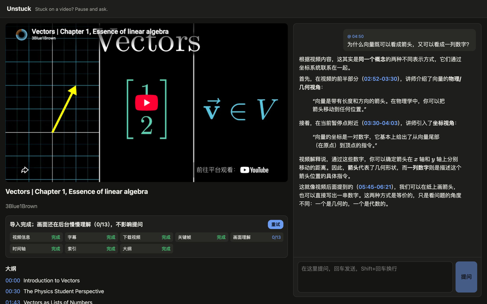
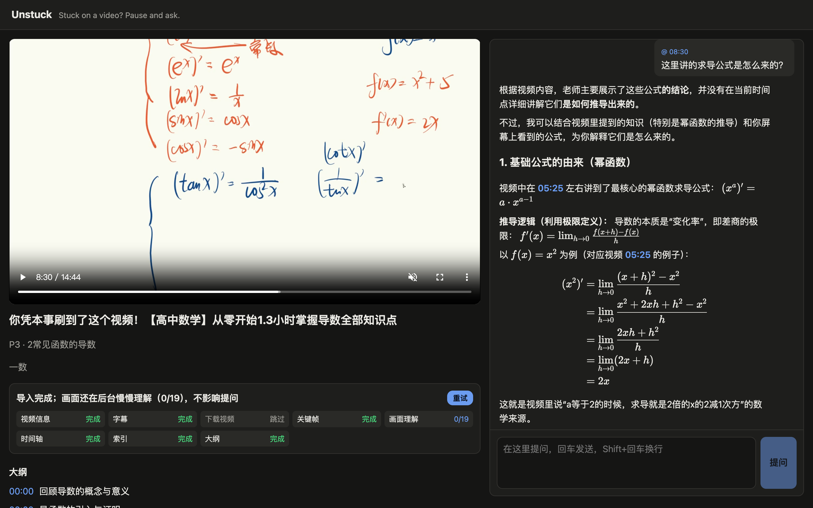
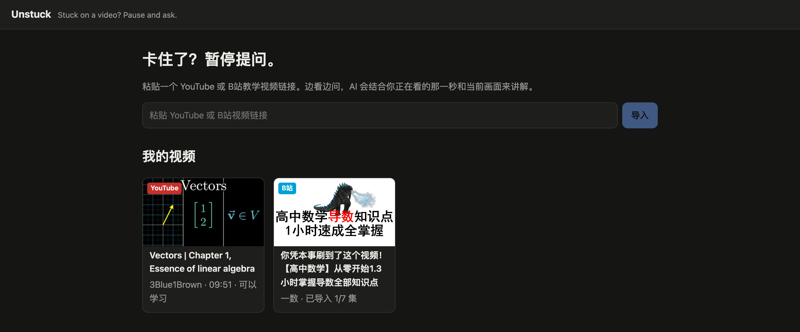

# Unstuck

[](https://github.com/samchenhub/unstuck-ai-tutor/actions/workflows/ci.yml)

> *Stuck on a video? Pause and ask.*

Unstuck is a one-on-one AI tutor that sits next to a YouTube **or Bilibili** lecture. Pause anywhere and ask a question: the tutor knows **which second you are at** and **what is on screen** (formulas, code, diagrams, slides), explains with the video's own content, and answers with clickable `[mm:ss]` timestamps and rendered LaTeX.

Products I looked at only read the transcript; research systems understand frames but don't know where the viewer is. Unstuck combines both at the pause point.



<table>
  <tr>
    <td width="50%"></td>
    <td width="50%"></td>
  </tr>
  <tr>
    <td>Bilibili: paused on the board, the tutor derives the formulas on screen.</td>
    <td>Paste a YouTube or Bilibili link; multi-part courses become one card.</td>
  </tr>
</table>

## How it works

```
YouTube or Bilibili URL
  └─ import pipeline (resumable)
       metadata → transcript → download → keyframes → timeline → index → outline
         │            │            │          │           │          └─ sqlite-vec (bge-m3)
         │            │            │          │           └─ 30–60 s segments cut at sentence ends
         │            │            │          └─ one frame every 45 s (≤ 200), phash dedupe; Bilibili: straight from the stream
         │            │            └─ YouTube only (Bilibili frames come from the online stream)
         │            └─ captions, else speech-to-text: Groq (cloud) or local Whisper, published as it goes
         └─ asking opens after the first transcribed minute (or at once with captions)
  └─ background: frames described one by one at the free tier's pace (GLM vision: kind, summary, OCR,
     change note), waiting out rate limits; the index is refreshed every 10 frames

Question at second t
  └─ context (~6k tokens):
       ① outline + current chapter   ② transcript t−90 s … t+15 s
       ③ current screen (live ffmpeg grab + vision if the last described frame is > 15 s old; a pending
          frame from the last 90 s is described on demand)
       ④ top-3 retrieved segments ("covered later" if after t)   ⑤ last 6 rounds
     → streamed answer (SSE) with [mm:ss] seek links and KaTeX
```

Design details: `docs/superpowers/specs/2026-10-09-unstuck-design.md`.

## Stack

FastAPI · SQLite + sqlite-vec · yt-dlp · ffmpeg · Groq Whisper API / faster-whisper · imagehash · React + TypeScript + Vite · KaTeX. Models go through one interface (`backend/unstuck/llm`); the defaults are Zhipu's free `glm-4.7-flash` (text) and `glm-4.6v-flash` (vision) plus local `BAAI/bge-m3` embeddings. Any OpenAI-compatible endpoint works by changing `.env`; for faster, more accurate answers at about ¥0.005 per question, use DeepSeek V4.1 Flash (`deepseek-flash`) for both chat and vision (see `backend/.env.example`). In a side-by-side test on real lectures it started answering in 2.4–3.9 s instead of 3–8.6 s, read the live screen every time (the free vision model was rate-limited 4 times out of 5) and avoided the free model's factual slips. Model calls retry with backoff (2/4/8/16/32 s) to ride out free-tier rate limits. The tutor answers in the language of the question.

## Run it locally

**Easiest (no setup)**: get a package built with `scripts/package.sh` (it contains the pre-built web page), unzip it and double-click `Unstuck.command` (macOS) or `Unstuck.bat` (Windows). The first run installs everything by itself — uv (official installer, no admin rights), Python, the AI components and ffmpeg (bundled) — which downloads about 2–3 GB and can take 10–20 minutes; later starts take seconds. Unstuck then opens at http://localhost:8000; close the window to stop it. On the first run it creates `backend/.env` from `.env.example`; put your key in `LLM_API_KEY` (Notepad is fine) and run it again. macOS and Windows warn once about a file from the internet: right-click → Open on macOS, More info → Run anyway on Windows.

**From a clone** (needs [Node](https://nodejs.org) 20.19+ to build the web page once): run `./start.sh` (macOS/Linux) or double-click `Unstuck.bat` (Windows); they build the page when it is missing or out of date. To build a package for others: `scripts/package.sh` (add `--with-env` to include your `backend/.env`, i.e. your API keys — only for people you trust).

For development with hot reload, run the backend and Vite separately (Vite on :5173 proxies `/api` to :8000):

```bash
cd backend && uv sync && uv run uvicorn unstuck.api.app:create_app --factory --port 8000
```

```bash
cd frontend && npm install && npm run dev
```

The backend loads the bge-m3 embedding model in a background thread at startup, so the first import does not pay for it (the first run downloads ~2 GB).

**Videos without captions** need speech-to-text. Recommended: get a free key at [console.groq.com](https://console.groq.com) (API Keys → Create) and put it in `GROQ_API_KEY` in `backend/.env`. Transcription then runs in the cloud (`whisper-large-v3-turbo`, about a minute for an hour-long lecture) and the laptop stays cool; the free tier covers roughly 2 hours of audio per hour and 8 per day, per account. Without a key, or when the cloud is unavailable or out of quota, Unstuck transcribes locally with faster-whisper (`WHISPER_MODEL`, default `small`, downloaded on first use): it works everywhere but keeps several CPU cores busy for minutes per hour of video.

Frames are described in the background after the import, at the free vision model's pace; rate limits are waited out, so the 画面理解 chip may take a while to reach its total. Asking never waits for it. If another stage (e.g. the outline) is rate-limited, Unstuck retries it automatically after 2, 5, 10, 20 and 30 minutes; **重试** (retry) re-runs only unfinished or failed stages.

## Bilibili

Paste a `bilibili.com/video/BV…` link (or a `b23.tv` share link). Multi-part courses import one part at a time; the video page lists the other parts with an import button.

**Log in by scanning a QR code**: when Bilibili is not logged in, the library shows 扫码登录; scan the code with the Bilibili mobile app and confirm. The login is saved locally in `backend/data/bilibili_cookies.txt` (keep it private; 退出登录 deletes it). This works on every platform. On macOS Unstuck can also read the login from your browser: `BILIBILI_COOKIES_BROWSER` in `backend/.env` accepts `chrome` (the macOS default), `safari`, `edge`, `firefox`, or empty (on macOS, Chrome asks once for Keychain access to "Chrome Safe Storage"); on Windows, Chrome's cookies cannot be read by other programs, so use the QR code. Logged in, it uses Bilibili's subtitles (uploader-made or AI-generated) and requests 720p playback; logged out it still works, but transcribes the speech (Groq or local Whisper) and plays at lower quality. Bilibili videos play straight from Bilibili's CDN in the browser's own player, so watching starts immediately.

This relies on Bilibili's unofficial web APIs; it is for personal use and demos.

## Tests

```bash
cd backend && uv run pytest -q                               # unit tests, no network
cd backend && UNSTUCK_IT_URL="<short CC video>" uv run pytest -m slow -s   # real end-to-end
cd frontend && npm test
```

## Evaluation

`eval/` compares answers from the transcript alone against transcript + screen on hand-written questions. The eval needs a hand-written `eval/questions.json` (format in `eval/questions.example.json`; see `eval/README.md`). Reports are written to `eval/results/`.

## Limits

- yt-dlp downloads are for personal use and demos. YouTube often blocks server IPs, so Unstuck runs locally only.
- Free vision models can misread complex formulas; switch `VISION_MODEL` to a stronger model if needed.
- Videos longer than 2 hours are rejected.
- On macOS you may see an `objc ... AVFFrameReceiver is implemented in both` warning at start-up. opencv and PyAV each bundle FFmpeg; it is harmless because Unstuck never opens capture devices.
